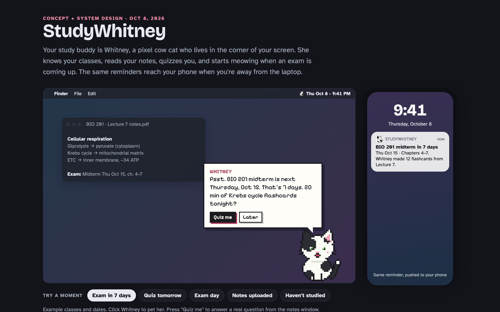
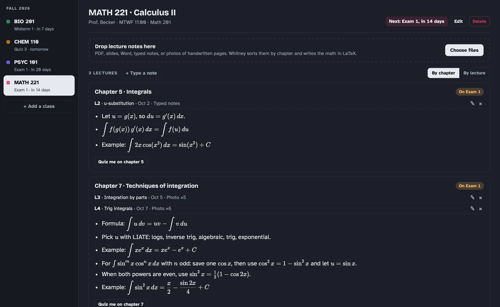
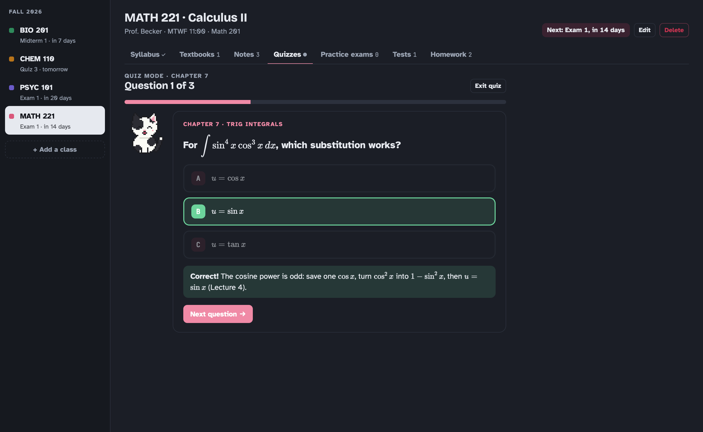

# StudyWhitney


**A study app for your Mac, with a little pixel cat named Whitney who keeps you on track.**

Add your classes, drop in your syllabus and notes, and StudyWhitney keeps everything organized, quizzes you, makes practice exams, and reminds you before tests.

*Still in progress. The Mac app works today; a phone version is planned.*



## Meet Whitney

Whitney sits just above your Dock while you work. She blinks, wanders around, and naps when you step away. When a test or assignment is coming up, she pops up to let you know and offers to quiz you. You can drag her anywhere on your screen, or hide her whenever you want.

## What you can do

**Keep each class in one place.** Every class gets its own space for the syllabus, textbooks, notes, tests and homework. You can add, change or delete anything.



**Never miss a test date.** Upload your syllabus and Whitney finds the exam and homework dates for you. She shows the line each date came from, so you can double-check before adding them.

**Review your notes by chapter.** Notes are grouped by chapter, and math is shown the way it looks in a textbook.

**Quiz yourself.** Quiz mode asks one question at a time, tells you right away if you got it right and why, and keeps track of the topics you need to work on.



**Get practice exams.** Upload an old exam and get a brand-new one just like it, or ask for questions on certain textbook sections. Print the questions to practice, then check your answers with the separate answer key. *This part needs a Claude API key, which costs a few cents per exam.*

## Try it

You'll need a Mac running macOS 13 or newer, and [Node.js](https://nodejs.org) (free).

1. Download this project (green **Code** button → **Download ZIP**) and unzip it.
2. Open Terminal and run:
   ```bash
   xcode-select --install
   cd ~/Downloads/studywhitney-main/mac-app
   ./build.sh
   ```
3. Open **StudyWhitney** from your Applications folder.

Just want a look? Open `studywhitney.html` in your browser to see the idea and try a demo.

## Coming next

- A phone app, so reminders reach you anywhere
- Whitney reading your notes for you and making flashcards
- Turning practice exams into quizzes

---

<sub>Built with Swift for the Mac app and JavaScript for the study screens. The `mac-app` folder has the app code, and `studywhitney.html` has the concept, a demo and the full design. Building needs the Xcode Command Line Tools and Node.js.</sub>
